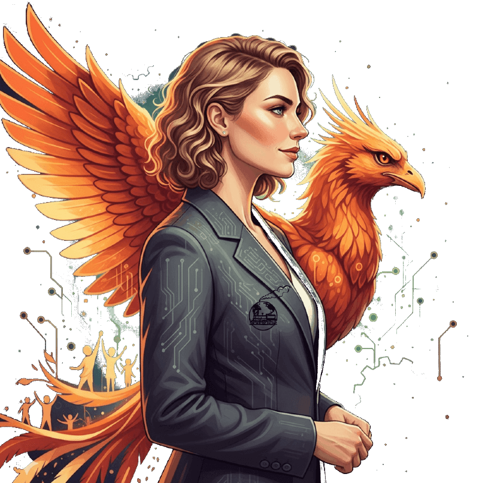
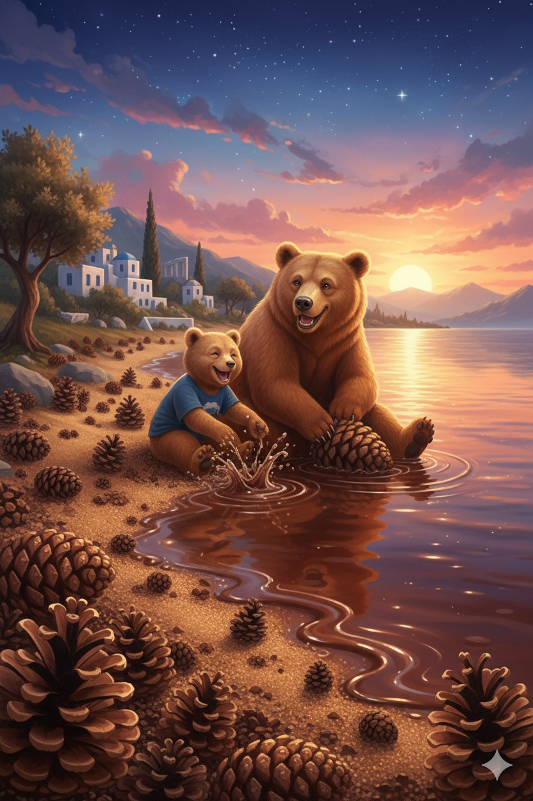
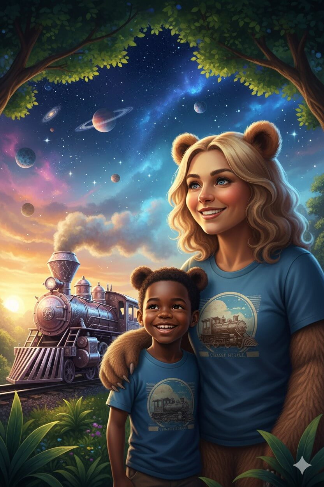

# HEIDI KALSKE-AKINTOBI

<div align="center">

**AI INNOVATION • CHILD ADVOCACY • TRAUMA-INFORMED TECH**

*Building the future where technology protects—not exploits*

---



[](https://hidikoo.github.io/Hidikoo/)

---

[](https://www.linkedin.com/in/heidi-kalske-akintobi-38065492)
[](https://github.com/Hidikoo)
[](https://www.photini.family)
[](mailto:hello@photini.family)

</div>

---

## ABOUT

After a decade in finance & risk management (**KPMG** & accounting and working banking sector), I founded **[Photini Family™](https://www.photini.family)** in 2025—an ecosystem combining **AI innovation**, **child protection advocacy**, and **trauma-informed technology**.

**My mission:** Create systems that embed human rights into their architecture—not as an afterthought.

---

## CURRENT FOCUS

```
🚀 Building Photini's Go-Driver              → AI-powered legal aid toolkit, Compliance by design (GDPR · EU AI Act)
                                                Architecture phase: DB schema & approved-source RAG registers first,  pressure-tested by a live ECtHR submission.
📄 Publishing December 2026                  → Executive briefing "Protecting the Child's Human Rights in Abduction Prevention" + legal essay "No Battlefield Required"
🐻 Cosmic Bear Adventure — Book 1             → Children's book series on hope & family separation.
                                                 Manuscript ready · safeguarding evaluation with trauma specialists & co-partner mapping · release 2027
🔍 Mapping Nordic child-protection failures  → Cross-border evidence for reform for child protection (UN CRC · CAT · ECtHR)
⚖️ Advocating Case Finland                   → Systemic reform in immigrant family & children's rights · UN & Council of Europe communications (CAT · GRETA) 2026–2027
```

---

## PHOTINI FAMILY™ ECOSYSTEM

<div align="center">


</div>

Three waves. One mission.

| **WAVE** | **MISSION** | **TECH** |
|----------|-------------|----------|
| **Photini™ apps** | Advocacy & case documentation | Go-Driver • Evidence management • AI compliance |
| **Rhea Network™ and Rhea apps** | Healing & trauma research | Data science • Trauma-informed AI • Evidence synthesis |
| **Nektarios™** | Governance & AI ethics | ISO frameworks • ERP • Compliance-by-design |

> *"Quality, trust, and data integrity with AI hand-in-hand with humans; misinformation is more dangerous than responsible data sharing."*

---

## FEATURED PROJECT: Photini's GO-DRIVER

**[Photini's Go-Driver](https://github.com/Hidikoo/Photini-Go-Driver)** – Next-generation advocacy & compliance platform

**What it does:**
Go-Driver transforms how advocates protect vulnerable populations by turning scattered evidence and manual processes into a secure, AI-augmented system that never forgets, always audits, and puts victims in control. It's a AI-powered co-pilot for NGOs, lawyers, and grassroots defenders—designed to amplify their impact while protecting the people they serve.

Go-Driver solves the crisis of evidence fragmentation and accountability gaps in human rights work. It consolidates case files, maintains immutable audit trails, and provides AI recommendations—always with mandatory human review. Think of it as a compliance-first command center for advocates who can't afford to lose a single piece of evidence or make a single privacy mistake, an aid kit that combines international case law, latest research and your case evidence into one clear information package.

Go-Driver pioneers **Compliance-by-Design** architecture—where ethics aren't bolted on after development, but embedded in the database schema, API logic, and AI workflows from day one from the ground up. It empowers advocates with AI-powered case management, evidence synthesis, and workflow automation—while ensuring every decision is traceable, every access is logged, and every vulnerable person's data and rights are protected.

*Built on:*
- ✅ GDPR Art. 25 (Privacy by Design) from database schema up
- ✅ EU AI Act transparency & mandatory human-in-loop controls
- ✅ Trauma-informed NLP for vulnerable populations
- ✅ ISO 27001/27701/42001 compliance roadmap

It will be built for NGOs, lawyers, and grassroots defenders who protect vulnerable populations—especially children and asylum seekers. It will later be developed to more wider use with its innovative design where it is suitable to solve many other problems among human rights, project management and human processes...

**Status:** **Architecture phase, schema-first.** DB schema, DB logic and the approved-source RAG registers — ECtHR jurisprudence, legality-supervision rulings, UN communications — are being built to court standard and validated on a live ECtHR submission (Q1 2027) before the backend resumes; the MVP follows. The sequence is the feature: a system that audits evidence must first prove itself on evidence. When children's evidence is the payload, built right beats built fast.

**[→ View Documentation](https://hidikoo.github.io/Photini-Go-Driver/)**

---

## COSMIC BEAR ADVENTURE

<div align="center">


</div>

**Journey of the Star Train** – A children's book series helping kids cope with family separation & trauma.

**The Story:** Little Otso the bear cub embarks on a cosmic journey aboard the magical Star Train—a tale of hope, courage, and love across impossible distances.

<table align="center">
  <tr>
    <td></td>
    <td></td>
    <td></td>
  </tr>
<table>

**Features:**
- 🐻 Age-appropriate emotional processing tools
- 💙 Trauma-informed guidance for adults (Collecting feedback from trauma professionals)
- 🌍 Bilingual (Finnish/English, later several other languages)
- 🎨 AI-generated illustrations

**Status:** Book 1 manuscript complete · safeguarding review and co-partner mapping with trauma professionals opening 2027 · release 2027 · Light Holders community live on Ko-fi.

🛡️ Safeguarding-first — no release before evaluation with trauma professionals; built to grow into a co-developed tool, not just a book.

---

## TECH STACK

```yaml
Backend:     Xano (no-code DB/API) • Docker • n8n
Frontend:    WeWeb • HTML/CSS/JS • GitHub Pages
AI/ML:       ChatGPT • Perplexity • Gemini 2.5 Flash • Kimi • Claude • Hugging Face • LangChain
Compliance:  ISO 27001/27701/42001 frameworks • GDPR tooling
Data:        Python • Pandas • Jupyter • RAG pipelines
Design:      AI-generated visuals • Canva • Higgsfield.ai
```

---

## BACKGROUND

### Professional Journey

| **PERIOD** | **ROLE** | **ORGANIZATION** | **FOCUS** |
|------------|----------|------------------|-----------|
| **2025–Present** | Founder & CEO | Photini Family™ | AI Ethics • Child Advocacy • Tech Innovation |
| **2017–2025** | Assistant Manager, Risk & Compliance | KPMG Finland | Public & Private Services Audit • GDPR • ESG • IT Audit|
| **2011–2017** | Financial Consultant, Accountant, Claims Handler & Buyer| Accountor (formerly Pretax) • Pohjola Insurance • Nokia Networks •  Ulvilan tilitoimisto • EY| Accounting & Regulatory Reporting (Accountor) • Personal-line Insurance (Pohjola) • Telecom Infrastructure Accounts (Nokia) • Auditing Associate and Accountant (Ulvilan tilitoimisto) • Audit Trainee (EY)|

### Education & Certifications

- 🎓 **Bachelor of Business Administration (BBA) Accounting and Finance** — Haaga-Helia University of Applied Sciences
- 🎓 **Master's studies (coursework completed, thesis pending), Accounting & Auditing — minor in Business Law** — University of Vaasa
- 📜 **International Law in Action: Investigating & Prosecuting International Crimes** — Universiteit Leiden (Coursera) · in progress
- 🤖 **AI Ethics & Governance** AI Systems & Governance — DataCamp: 9 certifications completed (agentic systems, LangChain, Hugging Face, n8n automation) · AI governance & ethics track in progress
- 🧠 **Trauma-Informed Design Principles** (Research-based)

---

## ADVOCACY & IMPACT

**Human Rights Focus:**
- 👶 **Child Protection Reform** — Documenting systemic failures in Nordic child welfare, with cross-border evidence
- 🌏 **Immigrant Family Rights** — Research on discrimination against minority families in protection systems
- 🔓 **Transparent & Auditable AI** — Building legal-aid tooling where every source is registered and verifiable, not a black box
- 💙 **Trauma-Informed Tech** — Designing systems that account for secondary trauma in users and subjects alike

**Current Work:**
- ⚖️ **Case Finland Advocacy** — Systemic reform in immigrant family & children's rights · UN & Council of Europe communications (CAT · GRETA) 2026–2027
- 📄 **December 2026 Publications** — Executive briefing "Protecting the Child's Human Rights in Abduction Prevention" + legal essay "No Battlefield Required"
- 🐻 **Cosmic Bear Adventure** — Healing stories for separated children · Book 1 in safeguarding review with trauma professionals, release 2027

---

## GITHUB STATS

<div align="center">


</div>

---

## CONTACT & COLLABORATION

I'm always open to:
- 🤝 **NGO Partnerships** — Go-Driver pilot testing and/or data sharing on cultural-assimilation challenges and children's human rights
- 🎨 **Trauma-Aid Professionals & Translators** — shaping the Cosmic Bear series toward its 2027 release
- 💼 **Impact Investors** — ethical AI for human rights
- 🔬 **Researchers** — trauma-informed AI design and legal-aid measures for child welfare
- 📰 **Media** — immigrant and vulnerable families' rights · AI ethics

**Reach out:**

| **CHANNEL** | **LINK** |
|-------------|----------|
| 💼 LinkedIn | [heidi-kalske-akintobi-38065492](https://www.linkedin.com/in/heidi-kalske-akintobi-38065492) |
| 📧 Community | [hello@photini.family](mailto:hello@photini.family) |
| 📧 Official | [info@photini.org](mailto:info@photini.org) |
| 📧 Personal | [heidi.kalskeakintobi@photini.family](mailto:heidi.kalskeakintobi@photini.family) |
| 🌐 Website | [www.photini.family](https://www.photini.family) |
| 💻 GitHub | [@Hidikoo](https://github.com/Hidikoo) |

---

## PHILOSOPHY

> **"Every child deserves a world where technology protects them, stories heal them, and networks unite them with those they love—no matter the distance."**

**Stories that heal | Technology that protects | Networks that unite**

---

<div align="center">


**Thank you for visiting.**

**Let's build a better future—one line of code, one story, one child at a time.**

💙 🚂 ✨

---

 &#124; 

This site scores **100/100 on Accessibility** and **100/100 on SEO** with Google Lighthouse.
See 🖥️ & 📱 reports (PDFs) in Portfolio

[](https://hidikoo.github.io/Hidikoo/)

---

**© 2025–2026 Heidi Kalske-Akintobi | Photini Family™**

</div>
